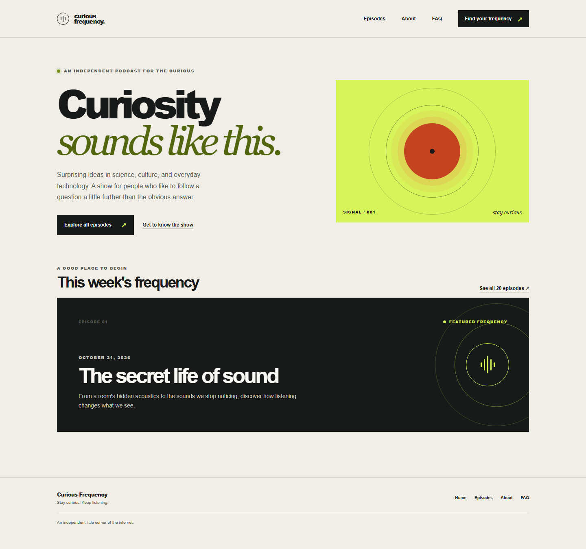

# Curious Frequency

A modern, responsive podcast website built with Next.js. The site introduces a fictional podcast about surprising ideas in science, culture, and everyday technology, and includes a featured episode, a 20-episode catalog, an About page, and an FAQ.

All episode and FAQ content is embedded in the project. This demo does not connect to a podcast feed, database, backend, or audio player.

## Application screenshot



The homepage pairs a short introduction and navigation links with a vivid, signal-inspired graphic. Below the hero, a featured episode card gives visitors a place to start and links to the full episode archive.

## Pages

| Route | Description |
| --- | --- |
| `/` | Podcast introduction and one featured episode |
| `/episodes` | Catalog of 20 fictional episodes with summaries and mocked publication dates |
| `/about` | Background on the show's subject and purpose |
| `/faq` | Answers to common questions about the show and this demo |

The layout adapts to mobile and desktop screens. It also includes semantic page landmarks, a skip link, visible keyboard focus styles, and reduced-motion support.

## Tech stack

- Next.js 16 App Router
- React 19
- TypeScript
- Static export (`output: "export"`)
- Embedded TypeScript content; no database or external feed

## Run locally

**Prerequisites:** Node.js 20.9 or newer and npm.

```bash
npm install
npm run dev
```

Open [http://localhost:3000](http://localhost:3000).

## Validate and build

```bash
npm run lint
npm run typecheck
npm run build
```

The static website is generated in `out/`. To preview the exported files locally, use a static file server, for example:

```bash
npx --yes serve out
```

When deploying, use a static host configured to serve the exported `.html` pages for clean routes—for example, `/episodes` should resolve to `out/episodes.html`. The same applies to `/about` and `/faq`.

## Project structure

```text
src/
  app/                 Next.js pages, layout, and global styles
  components/          Shared navigation, footer, and episode card
  content/podcast.ts   Podcast details, 20 episodes, and FAQ content
docs/
  screenshots/         Application screenshots
specs/
  001-podcast-website/ Feature specification and implementation notes
```
